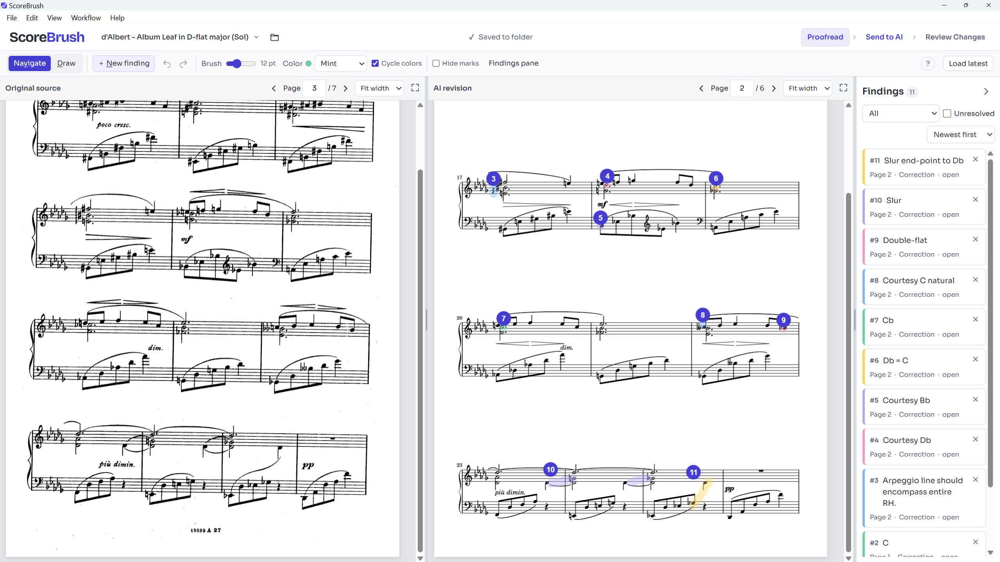
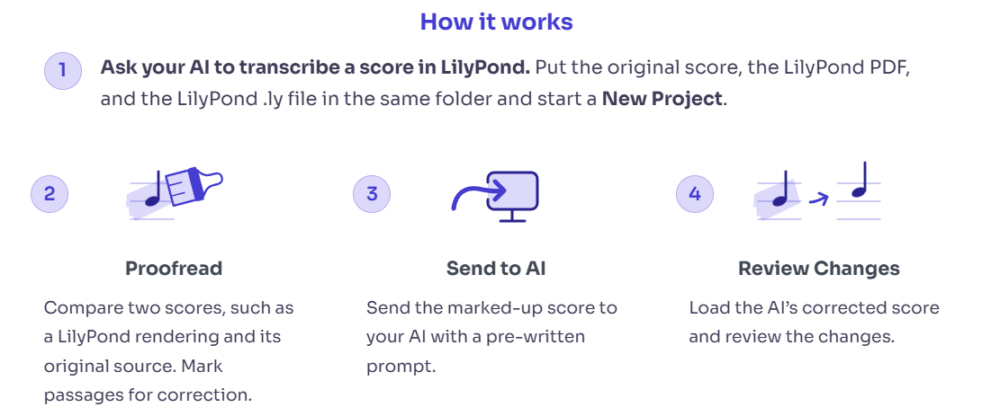

# ScoreBrush

ScoreBrush is a music transcription workspace for Windows. It allows you to compare an AI's
music transcription with a source PDF, mark corrections, and review changes.

**[Download ScoreBrush 0.1.0 for Windows x64](https://github.com/aug5thmusic/scorebrush/releases/download/v0.1.0/ScoreBrush-0.1.0-Windows-x64.zip)**

## Installation

1. Extract the ZIP file and open **ScoreBrush/ScoreBrush.exe**.
2. Choose **New Project**. Select a folder containing three files: the original
   printed or scanned music as a **source PDF**, your current transcription as a
   **transcription PDF**, and the transcription's **LilyPond `.ly` file**.
3. Assign those files when prompted, then start **Proofreading**.

Requires Windows 10 22H2 x64 or Windows 11 x64, .NET Framework 4.8/4.8.1 and
Microsoft's Stable WebView2 Runtime. The app is unsigned, so you may get a warning
when you run it for the first time.

## Essential controls

| To… | Use… |
| --- | --- |
| Mark a passage | **Draw** (`D`), then drag on the rendered score |
| Move around | **Navigate** (`V`) to drag the rendered page; **Page** arrows to turn pages |
| Add a note without drawing | **New finding** (`N`), then type your note |
| Finish a note | **Done** or `Enter` in the note. Wait for **Saved to folder** |
| Undo or redo | `Ctrl+Z`; `Ctrl+Shift+Z` or `Ctrl+Y` |
| Hide marks | `Ctrl+H` |
| Zoom | The zoom menu or `Ctrl+mouse wheel` over either PDF |

Notes autosave. Use **File → Save backup** for a portable copy. More controls
are under **Help → Keyboard shortcuts**.

## Work through a correction round

The ScoreBrush workflow is: **Proofread → Send to AI → Load latest → Review Changes**

* After proofreading, click **Send to AI**, then **Copy prompt**. Send it to your AI to follow the saved handoff instructions and apply your corrections. If your AI cannot access your project folder, use **Create ZIP / manual handoff**. Once the AI has updated the LilyPond and transcription PDF files, click **Load latest**.
* **Review Changes** to check the AI's work.
* Select **Looks correct** or **Still wrong** for each finding, or **Next** to skip. You can mark new findings at any time by switching back to **Proofread** mode or by drawing on the score.

## User Guides

The [user guide](documentation/USER_GUIDE.md) covers backups, recovery, versions
and storage limits. See also the [installation guide](documentation/INSTALLATION.md).

* [Security policy](https://github.com/aug5thmusic/scorebrush/blob/v0.1.0/SECURITY.md),
* [Development guide](https://github.com/aug5thmusic/scorebrush/blob/v0.1.0/DEVELOPMENT.md)
* [Contribution guide](https://github.com/aug5thmusic/scorebrush/blob/v0.1.0/CONTRIBUTING.md).

Copyright (C) 2026 Auggie (@aug5thmusic). Licensed **AGPL-3.0-or-later**, with
[additional permissions](LICENSING.md), without warranty. Read the
[license](LICENSE) and [third-party notices](THIRD_PARTY_NOTICES.md), also available
in **Help → About ScoreBrush**.
